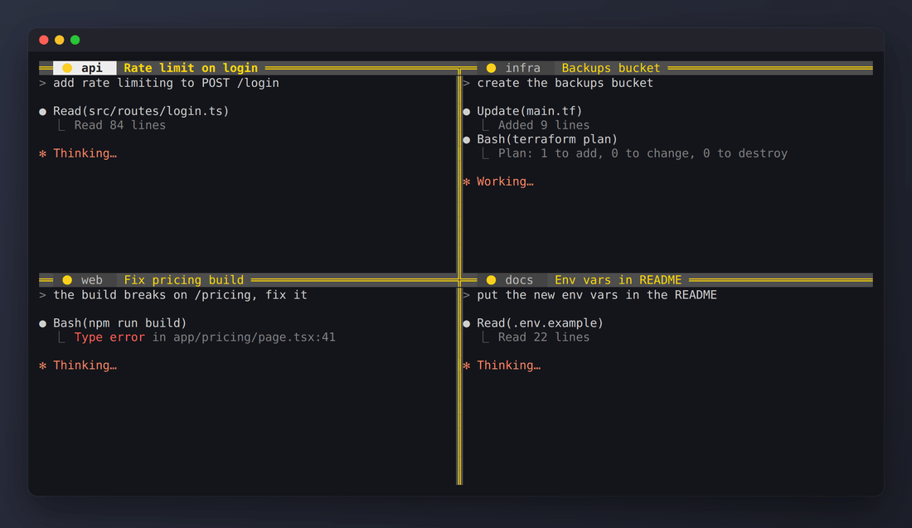

# beautify-tmux

Config tmux qui colore chaque panneau selon ce que fait la session Claude Code qui tourne dedans.

🟡 en cours &nbsp; 🟢 terminé &nbsp; 🔴 vous attend



[English](README.md) · [Português](README.pt-BR.md)

**Quoi.** Un `tmux.conf` et un script de hook. Chaque panneau reçoit un voyant dans sa barre de titre, et sa bordure prend la même couleur.

**Pourquoi.** Je garde quatre ou cinq agents Claude Code ouverts dans tmux, en SSH. L'un termine, un autre s'arrête pour demander une permission, et je ne m'en rendais compte que des minutes plus tard, en regardant ce panneau par hasard.

**Pour quoi faire.** Un coup d'œil à l'écran, on va au panneau rouge et on répond. Les panneaux verts sont libres pour la tâche suivante.

**Comment.** Claude Code lance des hooks sur ses propres événements. `install.sh --claude` en enregistre trois. Chacun appelle `hooks/tmux-light.sh`, qui définit une option de panneau appelée `@light`, et la couleur de bordure du `tmux.conf` lit cette option.

La config ajoute aussi une barre de titre avec le dossier et le titre de la session, des bordures à double trait, et Alt + flèches pour passer d'un panneau à l'autre.

## Installer

Il faut tmux 3.2 ou plus récent (`tmux -V`).

```sh
git clone https://github.com/felpk/beautify-tmux ~/.beautify-tmux
~/.beautify-tmux/install.sh
```

L'installeur ajoute une ligne `source-file` à votre `~/.tmux.conf` et garde une sauvegarde de l'ancien fichier. Si vous le lancez deux fois, la seconde ne change rien.

### Avec Claude Code

```sh
~/.beautify-tmux/install.sh --claude
```

Cela enregistre aussi trois hooks dans `~/.claude/settings.json` (il faut `jq`, et le fichier est sauvegardé avant) :

| Événement Claude Code | Voyant |
|---|---|
| Vous envoyez un prompt | 🟡 |
| Claude termine son tour | 🟢, ou 🔴 si la dernière ligne de la réponse est une question |
| Claude demande une permission ou une réponse | 🔴 |

Vos hooks existants restent en place.

### Avec autre chose

Le voyant n'est qu'une option de panneau appelée `@light`, donc n'importe quel script peut la définir. Le script de hook fonctionne tout seul :

```sh
~/.beautify-tmux/hooks/tmux-light.sh busy
make deploy && ~/.beautify-tmux/hooks/tmux-light.sh done || ~/.beautify-tmux/hooks/tmux-light.sh ask
```

Ou directement depuis tmux :

```sh
tmux set -p @light 🟢
tmux set -p -u @light   # l'éteindre
```

## Bordures partagées (optionnel)

Dans tmux d'origine, la bordure entre deux panneaux n'a qu'une seule couleur (celle du panneau actif), donc le voyant du voisin y disparaît. La barre de titre de chaque panneau montre toujours sa propre couleur, mais si vous voulez les deux couleurs sur la bordure :

```sh
~/.beautify-tmux/scripts/build-tmux.sh --install
```

Le script compile tmux 3.4 avec un petit patch (`patches/`) dans un conteneur Docker jetable et l'installe dans `/usr/local/bin/tmux`. Une bordure partagée est coupée en deux : le panneau sélectionné en dernier prend la moitié haute (bordure verticale) ou la moitié droite (bordure horizontale). Les sessions déjà ouvertes gardent l'ancien tmux, et le changement s'applique au prochain serveur (`tmux kill-server` ferme tout). Pour revenir en arrière : `rm /usr/local/bin/tmux`.

## Touches

| Touche | Action |
|---|---|
| `Alt + ←` `→` `↑` `↓` | Aller au panneau dans cette direction |
| `Prefix` puis `T` | Nommer le panneau (vide = revenir au titre du programme) |

Tout le reste est le tmux d'origine.

## Personnaliser

Ouvrez `tmux.conf`. Les couleurs sont des numéros de couleur tmux : `colour46` vert, `colour196` rouge, `colour220` jaune, `colour245` gris, `colour239` la bande derrière la bordure. Lancez `tmux source-file ~/.tmux.conf` après modification.

Si vous préférez des bordures à trait simple, remplacez `double` par `single` ou `heavy`.

## Désinstaller

```sh
~/.beautify-tmux/uninstall.sh
rm -rf ~/.beautify-tmux
```

Cela retire la ligne `source-file` et les hooks Claude Code ajoutés. Le reste de votre config n'est pas touché.

## Comment la démo a été faite

`scripts/demo.sh` lance ce `tmux.conf` dans un serveur tmux jetable et appelle `hooks/tmux-light.sh` comme le fait Claude Code, avec le même JSON sur stdin. Le texte des agents dans les panneaux est scripté. Playwright et ffmpeg transforment les écrans capturés en GIF.

## Licence

MIT
