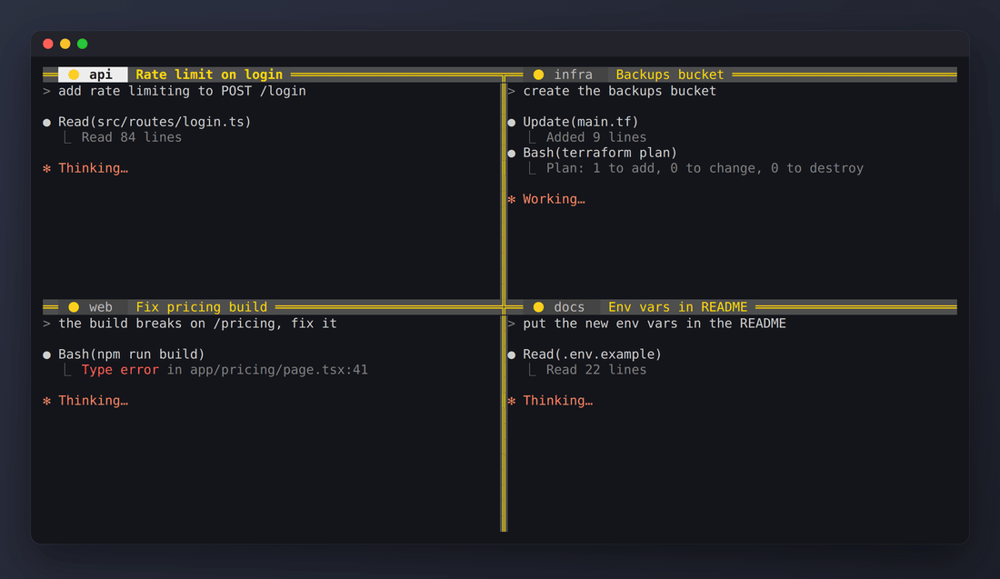

# beautify-tmux

tmux config that colours each pane by what the Claude Code session inside it is doing.

🟡 working &nbsp; 🟢 finished &nbsp; 🔴 waiting for you



[Português](README.pt-BR.md) · [Français](README.fr.md)

**What.** A `tmux.conf` and a hook script. Each pane gets a light in its title bar, and the border turns the same colour.

**Why.** I keep four or five Claude Code agents open in tmux over SSH. One finishes, another stops to ask for permission, and I'd only notice minutes later when I happened to look at that pane.

**What for.** Look at the screen, go to the red pane, answer it. Green panes are free for the next task.

**How.** Claude Code runs hooks on its own events. `install.sh --claude` registers three of them. Each one calls `hooks/tmux-light.sh`, which sets a pane option called `@light`, and the border colour in `tmux.conf` reads that option.

The config also adds a title bar with the folder and the session title, double-line borders, and Alt + arrows to move between panes.

## Install

You need tmux 3.2 or newer (`tmux -V`).

```sh
git clone https://github.com/felpk/beautify-tmux ~/.beautify-tmux
~/.beautify-tmux/install.sh
```

The installer adds one `source-file` line to your `~/.tmux.conf` and keeps a backup of the old file. Run it twice and nothing changes the second time.

### With Claude Code

```sh
~/.beautify-tmux/install.sh --claude
```

This also registers three hooks in `~/.claude/settings.json` (it needs `jq`, and it backs up the file first):

| Claude Code event | Light |
|---|---|
| You send a prompt | 🟡 |
| Claude finishes its turn | 🟢, or 🔴 if the last line of the reply is a question |
| Claude asks for a permission or an answer | 🔴 |

Your existing hooks stay where they are.

### With anything else

The light is just a pane option called `@light`, so any script can set it. The hook script works on its own:

```sh
~/.beautify-tmux/hooks/tmux-light.sh busy
make deploy && ~/.beautify-tmux/hooks/tmux-light.sh done || ~/.beautify-tmux/hooks/tmux-light.sh ask
```

Or set it straight from tmux:

```sh
tmux set -p @light 🟢
tmux set -p -u @light   # turn it off
```

## Split borders (optional)

In stock tmux, the border between two panes takes a single colour (the active pane's), so the neighbour's light disappears there. Each pane's title bar always shows its own colour, but if you want both colours on the border:

```sh
~/.beautify-tmux/scripts/build-tmux.sh --install
```

It builds tmux 3.4 with a small patch (`patches/`) in a throwaway Docker container and installs it to `/usr/local/bin/tmux`. A shared border is split in half: the most recently selected pane gets the top half (vertical border) or the right half (horizontal border). Sessions already running keep the old tmux; it takes effect with the next server (`tmux kill-server` closes everything). To go back: `rm /usr/local/bin/tmux`.

## Keys

| Key | Action |
|---|---|
| `Alt + ←` `→` `↑` `↓` | Move to the pane in that direction |
| `Prefix` then `T` | Name the pane (empty goes back to the program's title) |

Everything else is stock tmux.

## Customize

Open `tmux.conf`. The colours are tmux colour numbers: `colour46` green, `colour196` red, `colour220` yellow, `colour245` grey, `colour239` the strip behind the border. Run `tmux source-file ~/.tmux.conf` after editing.

If you'd rather have single-line borders, change `double` to `single` or `heavy`.

## Uninstall

```sh
~/.beautify-tmux/uninstall.sh
rm -rf ~/.beautify-tmux
```

It removes the `source-file` line and the Claude Code hooks it added. The rest of your config is left alone.

## How the demo was made

`scripts/demo.sh` runs this `tmux.conf` in a throwaway tmux server and calls `hooks/tmux-light.sh` the same way Claude Code does, with the same JSON on stdin. The agent output in the panes is scripted text. Playwright and ffmpeg turn the captured screens into the GIF.

## License

MIT
