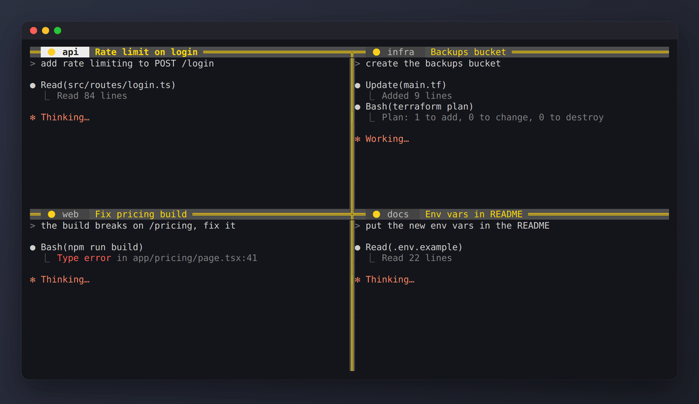

# beautify-tmux

Uma config pequena de tmux que coloca um sinal luminoso em cada painel. Eu rodo vários agentes de IA lado a lado pelo SSH e vivia me perdendo: qual ainda estava trabalhando, qual já tinha terminado, qual estava parado esperando eu responder. Agora a borda do painel me avisa.

🟡 trabalhando &nbsp; 🟢 terminou &nbsp; 🔴 precisa de você



[Read in English](README.md)

## O que faz

Cada painel ganha uma barra de título com o sinal, a pasta em que está e o título do painel. A borda pega a cor do sinal, então dá pra ver o estado de todos os painéis de longe. Painel sem sinal fica com a borda cinza, e o painel ativo ganha o rótulo branco.

As bordas são linha dupla sobre uma faixa cinza, o que dá um respiro entre os painéis quando a tela está cheia.

Alt + setas troca de painel sem apertar o prefixo.

É um arquivo só, com dez comandos de tmux. Sem gerenciador de plugin e sem motor de tema.

## Instalar

Precisa do tmux 3.2 ou mais novo (`tmux -V`).

```sh
git clone https://github.com/felpk/beautify-tmux ~/.beautify-tmux
~/.beautify-tmux/install.sh
```

O instalador coloca uma linha `source-file` no seu `~/.tmux.conf` e guarda um backup do arquivo antigo. Rodar duas vezes não muda nada na segunda.

### Com o Claude Code

```sh
~/.beautify-tmux/install.sh --claude
```

Também registra três hooks no `~/.claude/settings.json` (precisa do `jq` e faz backup do arquivo antes):

| Evento do Claude Code | Sinal |
|---|---|
| Você manda um prompt | 🟡 |
| O Claude termina a vez dele | 🟢, ou 🔴 se a última linha da resposta for uma pergunta |
| O Claude pede permissão ou uma resposta | 🔴 |

Os hooks que você já tinha continuam lá.

### Com qualquer outra coisa

O sinal é só uma opção de painel chamada `@light`, então qualquer script pode mexer nela. O script do hook funciona sozinho:

```sh
~/.beautify-tmux/hooks/tmux-light.sh busy
make deploy && ~/.beautify-tmux/hooks/tmux-light.sh done || ~/.beautify-tmux/hooks/tmux-light.sh ask
```

Ou direto pelo tmux:

```sh
tmux set -p @light 🟢
tmux set -p -u @light   # apaga
```

## Teclas

| Tecla | Ação |
|---|---|
| `Alt + ←` `→` `↑` `↓` | Vai pro painel naquela direção |

O resto é o tmux de fábrica.

## Personalizar

Abra o `tmux.conf`. As cores são números de cor do tmux: `colour46` verde, `colour196` vermelho, `colour220` amarelo, `colour245` cinza, `colour239` a faixa atrás da borda. Depois de editar, rode `tmux source-file ~/.tmux.conf`.

Se preferir borda simples, troque `double` por `single` ou `heavy`.

## Desinstalar

```sh
~/.beautify-tmux/uninstall.sh
rm -rf ~/.beautify-tmux
```

Remove a linha `source-file` e os hooks do Claude Code que ele colocou. O resto da sua config fica como está.

## Como o GIF foi feito

O `scripts/demo.sh` sobe um servidor tmux descartável com esta config, conecta nele a partir de um segundo servidor descartável e captura a tela quadro a quadro. Os quadros passam por um conversor pequeno de ANSI pra HTML, o Playwright tira os prints e o ffmpeg junta o GIF. Ou seja, o GIF lá em cima é a config de verdade, não uma montagem.

## Licença

MIT
